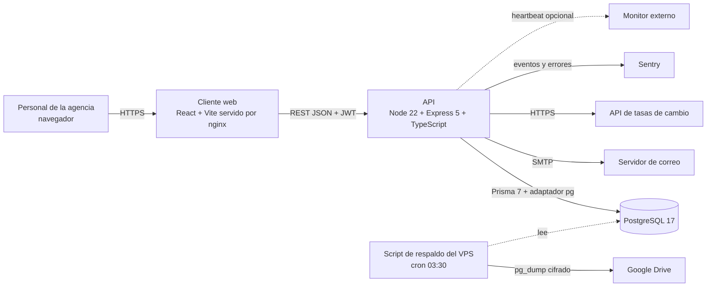
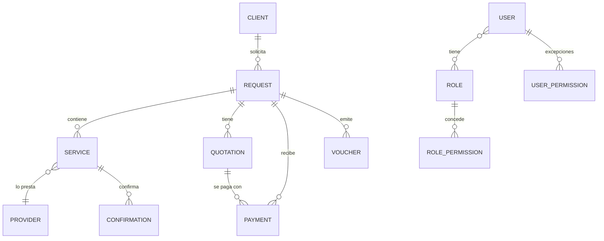
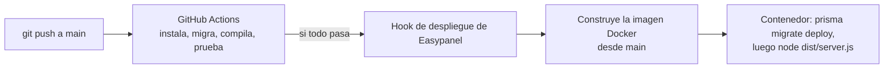

# Arquitectura de Adetravel

Última revisión: 15 de octubre de 2026. Las decisiones con sus alternativas y consecuencias están en [`adr/`](adr/README.md). El estado de calidad y el plan de trabajo están en [`CALIDAD.md`](CALIDAD.md).

## 1. Qué es y qué problema resuelve

Sistema de gestión para una agencia de viajes: clientes, solicitudes de viaje, servicios (alojamiento, pasaje aéreo, seguro, visa, traslado, excursión, crucero, circuito, arriendo de auto), proveedores, cotizaciones, confirmaciones, pagos y vouchers, con reportes, tareas, notificaciones y bitácora. Reemplaza el trabajo repartido entre WhatsApp, correo y hojas de cálculo.

Usuarios: el personal de la agencia (administrador y roles con permisos por módulo). Los clientes finales **no** acceden al sistema.

## 2. Vista general

Dos piezas desplegables por separado, en el mismo servidor (un VPS con Easypanel sobre Docker): `adetravel-api` y `adetravel-client`. La base de datos es un servicio PostgreSQL de Easypanel.

## 3. API (`adetravel-api`)

**Stack:** Node 22, Express 5, TypeScript, Prisma 7 con el adaptador `pg`, zod para validar, pino para logs, `@sentry/node`, `node-cron`, `nodemailer`, `@react-pdf/renderer` para los PDF, `helmet`, `express-rate-limit`.

**Capas** (`src/`):

| Carpeta | Responsabilidad |
|---|---|
| `routes/` | Declara endpoints y encadena middlewares (autenticación, permiso, validación). Sin lógica. |
| `middlewares/` | Autenticación JWT, permisos, validación con zod, límites de peticiones, `requestId`, manejo de errores, ocultar datos del cliente a quien no tiene permiso. |
| `controllers/` | Orquesta una petición: lee datos validados, llama a servicios o Prisma, responde con el formato común. |
| `services/` | Reglas de negocio reutilizables: flujo de estados, reglas de pago, cálculo de cotización, numeración, tasas de cambio, correo, PDF, tendencias del panel. |
| `validators/`, `schemas/` | Esquemas zod de entrada. El flujo de estados vive en `validators/workflow-status.ts`. |
| `lib/` | Cliente Prisma y sus extensiones (cifrado de datos personales, orden estable de `system_config`), búsqueda sin tildes, tokens. |
| `jobs/` | Trabajos programados: avisos de atraso, respaldo desde la app, espacio en disco. |
| `utils/` | Logger, errores, respuesta común, enmascarado de datos personales, dinero, fechas. |
| `ops/` | Scripts operativos compilados con la app (rotación de clave, cifrado retroactivo). |

**Formato de respuesta y errores:** respuesta común (`utils/response.ts`) con `data`, y listas con `total`, `page`, `limit`. Los errores de negocio son `ApiError` con un `code` estable (por ejemplo `QUOTATION_EXPIRED`, `PARTIAL_PAYMENT_NOT_ALLOWED`) que el cliente puede interpretar.

**Orden de los middlewares** (`app.ts`): `requestId` y log de petición, `helmet`, CORS restringido a `FRONTEND_URL`, JSON de hasta 2 MB, `/health` y `/api/health` (antes del límite de peticiones), límite de peticiones, rutas bajo `/api`, 404, manejador de errores.

## 4. Cliente (`adetravel-client`)

**Stack:** React 18, Vite 5, TypeScript, React Router 7, TanStack Query 5, react-hook-form + zod, Tailwind + componentes shadcn/Radix, Recharts, `@sentry/react`. Pruebas con Vitest y Testing Library.

- `pages/` pantallas por ruta, `components/<módulo>/` piezas de cada módulo, `hooks/` acceso a datos con TanStack Query, `lib/api.ts` cliente HTTP único, `context/AuthContext.tsx` sesión y permisos.
- Las rutas se protegen con `ProtectedRoute` y `PermissionGuard`; lo que el usuario no puede ver, el servidor tampoco se lo entrega (la verificación real está en el API).
- Se sirve como archivos estáticos con nginx: `index.html` sin caché, `/assets` con hash e inmutables, cabeceras de seguridad, y respuesta 404 real para recursos inexistentes.

## 5. Modelo de datos (PostgreSQL)

Entidades principales (`prisma/schema.prisma`, 13 migraciones):

Otras tablas: `activity_logs` (bitácora), `tasks`, `notifications`, `email_templates`, `revoked_tokens`, `permission_audits`, `system_config` (una sola fila: datos de la agencia, SMTP, tasas de cambio, textos legales) y los catálogos (países, ciudades, regiones, nacionalidades, tipos, marcas y modelos de auto).

Detalles del servicio de cada tipo viven en una columna JSON (`services.details`) validada con zod según el tipo.

## 6. Flujo de trabajo de una solicitud

Una máquina de estados de 17 pasos compartida por solicitud y servicio, definida en `validators/workflow-status.ts` y aplicada por `services/workflow.service.ts`:

`RECEPCIONADA → SERVICIOS_ASIGNADOS_PARA_COTIZAR → ENVIADO_A_PROVEEDOR → COTIZADO_POR_PROVEEDOR → COTIZADO_POR_ADETRAVEL → ENVIADO_AL_CLIENTE → ACEPTADA_POR_CLIENTE → ENVIADA_SOLICITUD_CONFIRMACION_PROVEEDOR → CONFIRMADA_POR_PROVEEDOR → ENVIADA_CONFIRMACION_CLIENTE → ENVIADA_SOLICITUD_PAGO_CLIENTE → PAGADO_POR_CLIENTE → PAGADO_AL_PROVEEDOR → VOUCHER_EMITIDO → VOUCHER_ENTREGADO → VENDIDA`, con `CANCELADA` alcanzable desde casi cualquier paso.

Reglas clave: las transiciones permitidas son una tabla explícita; el estado de los servicios "burbujea" a la solicitud cuando todos llegan al mismo; en solicitudes tipo paquete el estado desciende de la solicitud a sus servicios; nunca se retrocede un estado ni se reactiva una entidad cancelada salvo la reversa documentada de un pago. Acciones como crear o aceptar una cotización, registrar una confirmación o completar un pago **avanzan el flujo** como efecto.

## 7. Seguridad

| Tema | Cómo está resuelto |
|---|---|
| Autenticación | JWT con `jti` y versión de token. Cambiar o restablecer la contraseña invalida los tokens anteriores. El cierre de sesión guarda el token en `revoked_tokens`, así la revocación sobrevive a los despliegues. |
| Autorización | Roles con permisos por módulo (`VIEW_*`, `MANAGE_*`, `DELETE_*`) y excepciones por usuario (conceder o revocar). Cambios auditados en `permission_audits`. |
| Datos personales | Cifrado AES-256-GCM en reposo de pasaporte, cuenta bancaria, titular, y pasaporte/RUT dentro de `services.details`, mediante extensiones de Prisma (transparente para el resto del código). Rotación de clave con script y ensayo. |
| Visibilidad | Quien no puede ver clientes solo recibe `id`, nombre y apellido dentro de otras respuestas (`client-visibility`). |
| Entrada | Validación zod en cada endpoint; sanitizado del HTML de textos legales; límite de peticiones global y límite propio del login. |
| Transporte y cabeceras | `helmet` en el API; cabeceras de seguridad en nginx; CORS a un origen. |
| Secretos | Solo en variables de entorno; claves de GitHub en *Secrets*; el script de respaldo guarda su clave aparte con permisos 600. |
| Privacidad en observabilidad | Logs y Sentry pasan por enmascarado (`pii-scrub`, `sentry-scrub`); hay pruebas. |

## 8. Observabilidad y operación

- **Logs:** pino en JSON, con `requestId` por petición, devuelto al cliente en `X-Request-Id`.
- **Errores:** Sentry en API y cliente, con limpieza de datos sensibles antes de enviar.
- **Salud:** `/api/health` ejecuta `SELECT 1`; el `HEALTHCHECK` del contenedor lo usa.
- **Alertas operativas:** respaldo fallido y disco bajo por correo; latido (*heartbeat*) opcional a un monitor externo.
- **Respaldos:** dos mecanismos. (1) Trabajo `backupDatabase` del propio API hacia un bucket S3-compatible, solo si se configuran las variables `BACKUP_S3_*`. (2) Script del VPS (`backup-dbs.sh`, cron 03:30) que vuelca **todas** las bases cifradas con una clave propia y las sube a Google Drive. Hay ensayo de restauración automatizado (`npm run restore:drill`).
- **Runbook:** [`../OPERATIONS.md`](../OPERATIONS.md): despliegue, vuelta atrás, migración fallida, alertas, réplicas.

## 9. Despliegue

- Imagen del API en dos etapas; ejecuta como usuario `node`; `tini` como PID 1; `pg_dump` 17 incluido para el respaldo.
- Al arrancar corre `prisma migrate deploy` antes de escuchar el puerto.
- Con varias réplicas, solo una debe tener `JOBS_ENABLED=true`.

## 10. Calidad

Resumen (detalle y huecos en [`CALIDAD.md`](CALIDAD.md)): 71 archivos de prueba en el API (333 unitarias y 153 e2e contra Postgres real) y 215 pruebas en el cliente; CI en ambos repos que bloquea el despliegue si algo falla; cobertura real del API en `src/` de 77,8 % de sentencias.

## 11. Límites conocidos

Listados con honestidad en [`CALIDAD.md`](CALIDAD.md) y en los ADR: importes guardados como `Float`, numeración correlativa por consulta del máximo, cobertura baja en el cliente, `main` sin protección de rama, y reglas de negocio asumidas pendientes de confirmar con el dueño (`../DECISIONES_PENDIENTES.md`).
